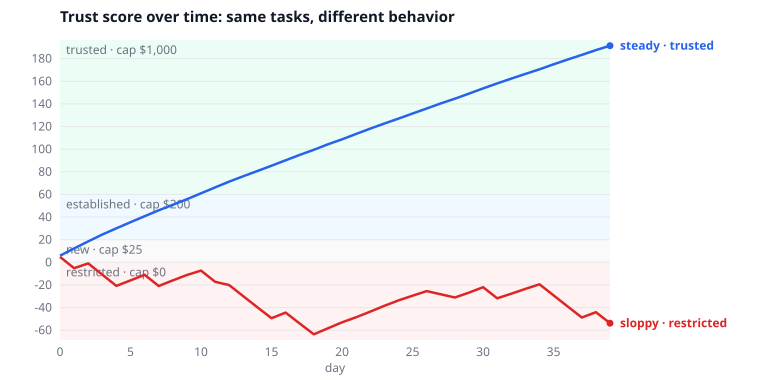

# earnest

**Agents earn spending limits by behaving well.**

`earnest` is an open spec and reference gateway for giving AI agents money safely. Agents never hold a card.
They ask the gateway to spend; the gateway decides based on three things:

1. **Who you are**: a *profile* of how you like money spent (frugal or convenience-first, hands-off or cautious, privacy-conscious, …).
2. **What this task is**: a *mandate* ("surprise birthday gift for Sam, $50–80, ship to me, by the 14th, show me 3 options first").
3. **What the agent has earned**: a *trust score* per agent and task type, built from staying inside mandates and from outcomes you accept.

Approved requests get a scoped, expiring payment credential (a capped, single-use virtual card in test mode). The outcome feeds back into the trust score: limits **rise slowly** with good behavior and **fall sharply** on violations, like a credit line.

> **Status: v0.1.** Spec, gateway, mock payment backend, MCP server and demo. Nothing here handles real money: mock backend only.



*Same user, same 40 tasks. The faithful agent reaches `trusted` and stops needing approval; the sloppy one ends up `restricted`.*

## Quickstart

Needs Python 3.10+. The core has no dependencies.

```bash
git clone https://github.com/hardikashah-eng/earnest-agent-pay.git
cd earnest-agent-pay
python -m earnest demo                # two-agent simulation, writes demo/limits.svg
python -m unittest discover -s tests  # run the tests
```

```
agent    final tier    score  accepted  violations  asked you  vs fair price
steady   trusted       191.4        40           0          6          -8.3%
sloppy   restricted    -53.8        22          15         25         +18.4%
```

### Try the flow yourself

```bash
python -m earnest profile examples/profile-frugal.json
python -m earnest mandate examples/mandate-software.json
python -m earnest request examples/request-subscription.json   # denied: you said no subscriptions
python -m earnest request examples/request-ok.json             # escalated: new agent, new merchant
python -m earnest pending --user user_demo
python -m earnest approve <request_id>                         # issues a $45 single-use card
python -m earnest outcome <request_id> accepted                # you rate it; the score updates
python -m earnest limits --user user_demo --agent agent_shopper --task software
```

### Connect an agent over MCP

```bash
pip install -e ".[mcp]"
```

Then add the server to your MCP client (e.g. Claude Desktop / Claude Code config):

```json
{
  "mcpServers": {
    "earnest": {
      "command": "python",
      "args": ["-m", "earnest.mcp_server"],
      "cwd": "/path/to/earnest-agent-pay",
      "env": { "EARNEST_DB": "earnest.db", "EARNEST_USER_ID": "user_demo", "EARNEST_AGENT_ID": "agent_shopper" }
    }
  }
}
```

The agent gets three tools: `list_mandates`, `get_limits` and `request_spend`. Its identity comes from the server's environment, not tool arguments, and only you report outcomes (via the CLI), so the agent can't grade itself.

---

## Why

Today, agent spending is either too loose (a real card with a hard cap) or too tight (approve every purchase by hand). Neither scales.
People and credit systems handle trust the same way: start small, extend more as it's earned. `earnest` applies that to agents, and measures "good behavior" against *your* preferences, not generic rules.

## How it works

```
Agent ──(spend request + reason)──▶ earnest gateway ──▶ payment backend (mock / Stripe Issuing test mode)
                                      │                   issues a capped, expiring credential
                                      ├─ check against the mandate
                                      ├─ apply profile preferences
                                      ├─ apply limits from the agent's trust tier
                                      └─ record outcome ──▶ trust score updates future limits
```

The gateway is exposed as an **MCP server**, so Claude or any MCP-capable agent can call tools like
`request_spend(amount, merchant, category, reason)`.

Full rules and point values: [spec/SPEC.md](spec/SPEC.md).

### Trust tiers

| Tier | Per-transaction cap | Credential lifetime | Needs your approval |
|---|---|---|---|
| Restricted (score < 0) | $0 | — | Everything |
| New (0+) | $25 | 1 hour, single use | Over $10, or a new merchant |
| Established (20+) | $200 | 24 hours, single use | Over $150, or a new merchant |
| Trusted (60+) | $1,000 | 7 days | Over $500 |

Anything outside the mandate (over budget, wrong category, blocked merchant, past deadline, against your hard rules) is denied at every tier and costs the agent 10 points. Your `autonomy` setting scales the approval thresholds.

### What earns trust

- **Faithfulness**: purchases inside the mandate; no disputes or refunds; asking for approval *before* acting when unsure.
- **Efficiency**: scored *only for accepted outcomes*, as value against a benchmark. Underspending isn't rewarded by itself, since that invites cutting corners.
- **Profile-aware**: a frugal user's agent scores well for waiting for a deal; a convenience-first user's agent doesn't.

## Repository layout

```
spec/              JSON Schemas (profile, mandate, spend request, decision, outcome), trust tiers, SPEC.md
earnest/           the gateway
  models.py        spec objects + validation
  rules.py         decision procedure (approve / deny / escalate)
  scoring.py       trust points and decay
  ledger.py        SQLite ledger
  gateway.py       ties it together
  backends/mock.py simulated scoped, expiring cards
  mcp_server.py    agent-facing MCP tools
  cli.py           user-facing commands
  simulate.py      two-agent demo
examples/          sample profile, mandates and requests
demo/limits.svg    demo chart
tests/             unit tests
docs/SCOPE.md      scope and roadmap
```

## Related work

`earnest` aims to sit *on top of* existing rails, not replace them: Visa Intelligent Commerce and Mastercard Agent Pay (agentic tokens), Google AP2 (intent and cart mandates), OpenAI/Stripe Agentic Commerce Protocol, Coinbase x402, and ERC-8004 (agent identity and reputation).

## License

[Apache-2.0](LICENSE)
